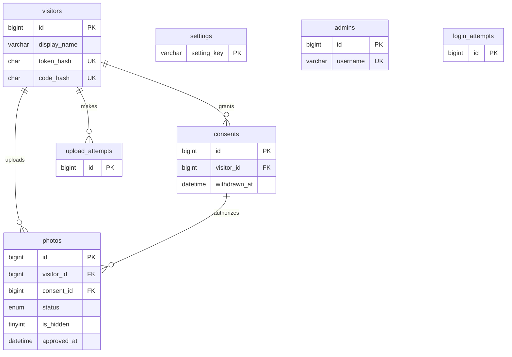
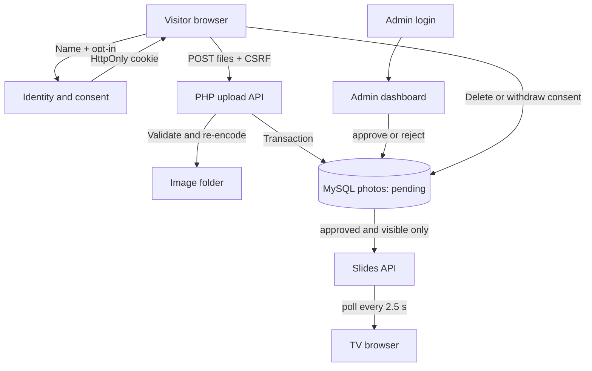
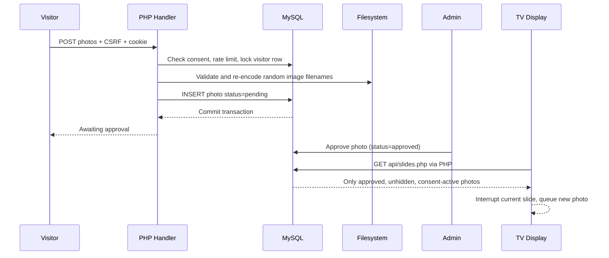

# Architecture

## Rationale
Apache on WampServer provides a familiar PHP/MySQL local environment. PDO with native prepared statements prevents SQL parameter interpolation; vanilla JS provides async uploads and near-realtime polling without build tools. MySQL InnoDB supplies transactions and row locks.

## Entity relationships

## System flow

## Upload sequence

## Important constraints
- The admin dashboard accepts/rejects each photo individually. Every subsequent upload is another request.
- The slideshow polls the **full approved state**, not just new IDs, so approving an old pending photo or deleting an approved photo takes effect. Response is capped at 500 slides for demo scale.
- No raw access token, recovery code or admin password is stored in the database; only SHA-256/HMAC or password hashes.
- Cookies use HttpOnly and SameSite=Lax. CSRF is checked on all mutating forms; admin sessions are regenerated on login.
- Input files are MIME + `getimagesize()` checked and decoded/re-encoded by GD, stripping EXIF. Random names and Apache script execution restrictions reduce upload risk.
- MySQL transactions + per-visitor `FOR UPDATE` lock prevent quota races and duplicate writes. Files are not transactional; process crashes can produce orphaned images, requiring cleanup.
- Deletion/withdrawal removes rows and files. A TV showing an image may keep it until its next successful poll (normally <=2.5 seconds); network failure can delay removal. Cached or externally copied images cannot be recalled.
