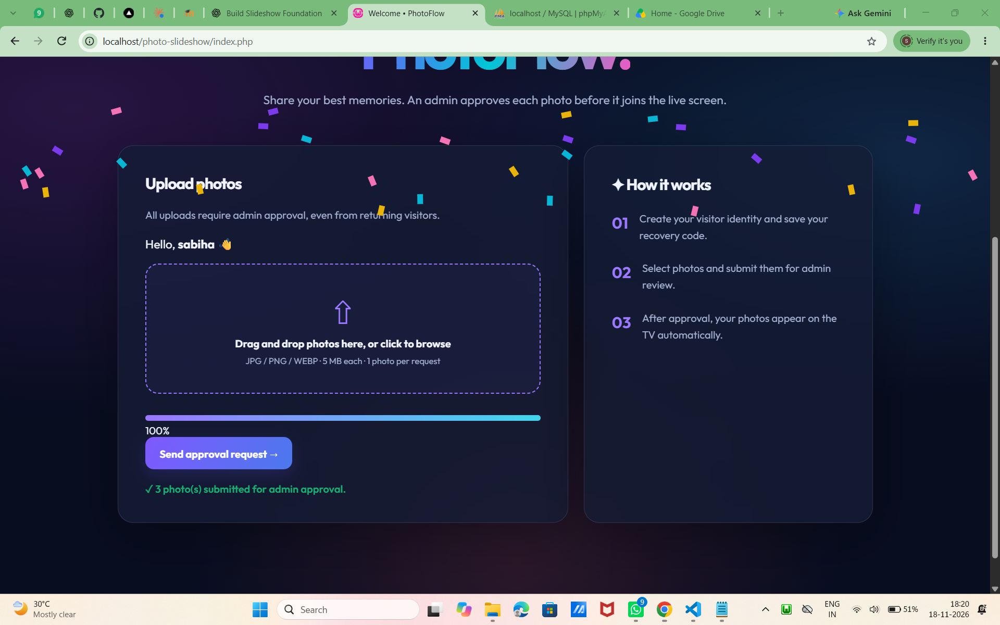
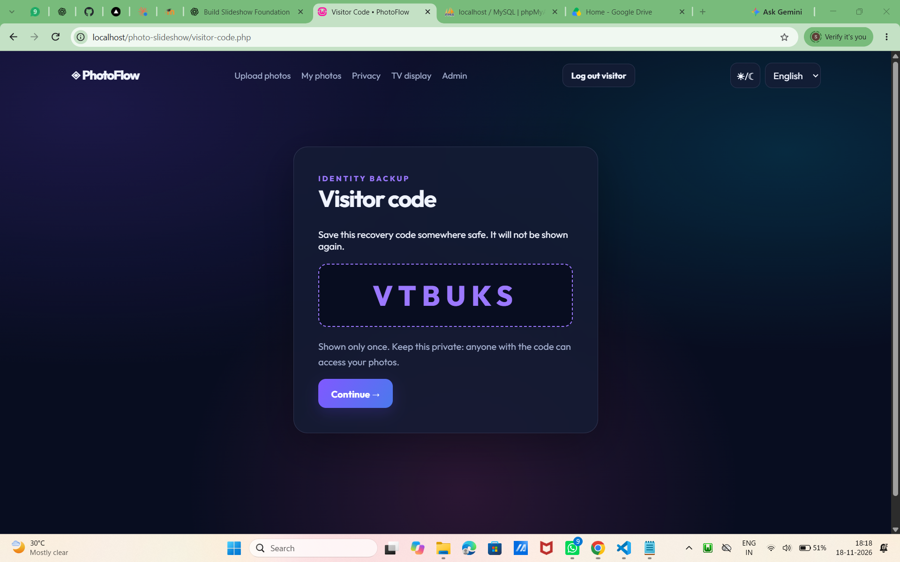
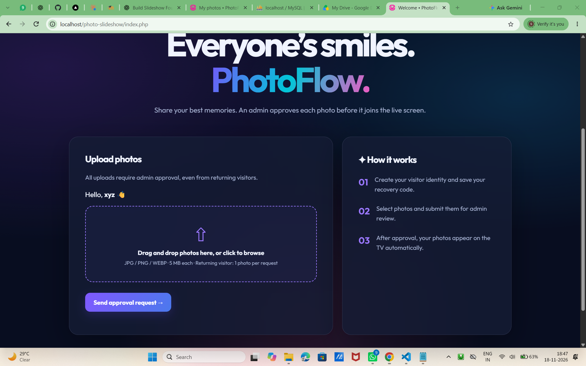
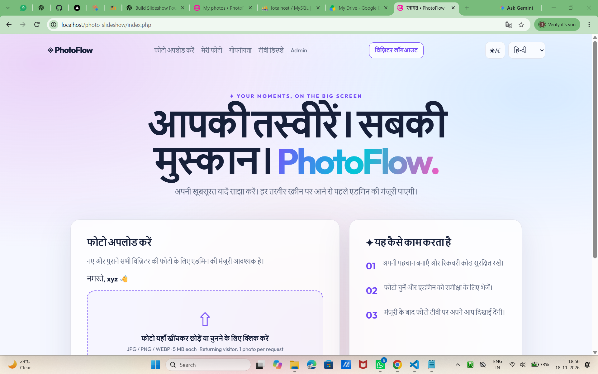
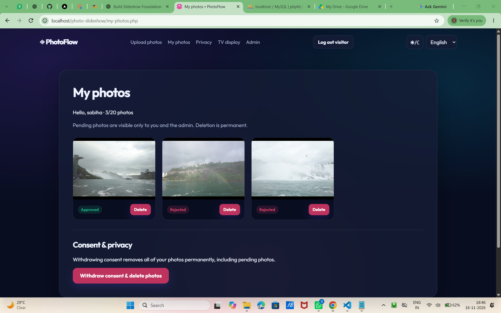
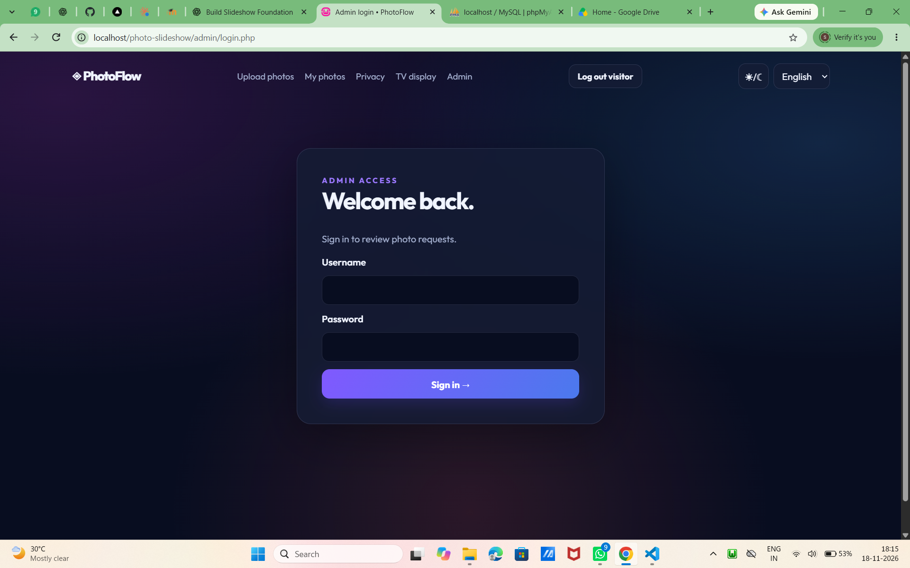
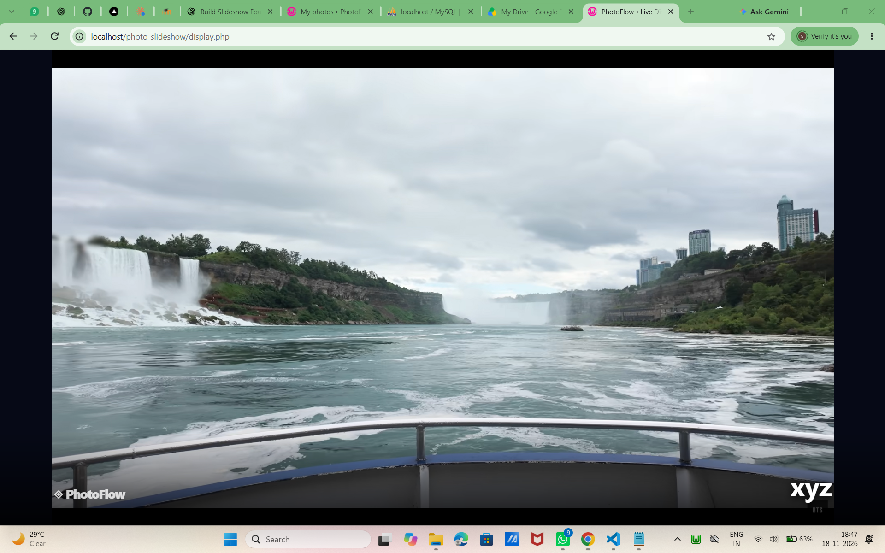

# PhotoFlow — Visitor Photo Slideshow

A web-based Visitor Photo Slideshow application developed using PHP, MySQL, HTML, CSS, and JavaScript.

## Project Overview

PhotoFlow allows visitors to upload photos and submit them for administrator approval. Only approved photos are displayed on the slideshow screen.

The application supports returning visitors, secure photo uploads, consent management, and an administrator dashboard.

## Technologies Used

- Frontend: HTML5, CSS3, Vanilla JavaScript
- Backend: PHP 8.x
- Database: MySQL
- Web Server: Apache (WampServer)
- Database Management: phpMyAdmin

## Features

### Visitor Features

- Visitor registration using name and consent
- Unique visitor identity and recovery code
- Upload up to 3 photos on the first upload request
- Upload 1 photo per request after the first upload
- Visitor login and logout
- View uploaded photos
- Delete uploaded photos
- Withdraw consent

### Admin Features

- Password-protected administrator login
- Administrator dashboard with sidebar navigation
- View pending photo requests
- Approve or reject uploaded photos
- Hide, unhide, and delete photos
- Change slideshow duration
- Administrator logout

### Slideshow Features

- Displays administrator-approved photos only
- Automatic slideshow updates without page refresh
- Priority for newly approved photos
- Visitor names displayed as captions
- Smooth slideshow transitions

### Additional Features

- English, Hindi, and Gujarati language support
- Dark and light theme
- Responsive interface
- Image validation and resizing
- CSRF protection and upload rate limiting

## Installation and Setup

1. Install WampServer with Apache, PHP 8.x, and MySQL.
2. Start Apache and MySQL.
3. Download or clone this repository.
4. Copy the project folder to `C:\wamp64\www\photo-slideshow`.
5. Open `http://localhost/photo-slideshow/`.
6. On a compatible default WampServer installation, follow the automatic database setup.
7. If automatic setup is unavailable, create a database named `photo_slideshow`, import `schema.sql`, and configure `.env` using `.env.example`.
8. Enable the PHP extensions `gd`, `fileinfo`, and `pdo_mysql`.
9. Complete the administrator setup locally.

## Application Pages

| Page | Local URL |
|---|---|
| Visitor Home | `http://localhost/photo-slideshow/` |
| Admin Login | `http://localhost/photo-slideshow/admin/login.php` |
| TV Slideshow | `http://localhost/photo-slideshow/display.php` |
| My Photos | `http://localhost/photo-slideshow/my-photos.php` |

## Admin Login

The administrator account is configured locally during installation.

For security reasons, actual administrator credentials are not included in this public repository.

## Photo Approval Workflow

1. A visitor enters their name and provides consent.
2. The visitor selects photos and submits an upload request.
3. Uploaded photos receive a pending status.
4. The administrator reviews each photo.
5. Approved photos become eligible for the TV slideshow.
6. Rejected photos are not displayed.
7. Returning visitors must also obtain approval for new uploads.

## Security and Privacy

- PHP PDO prepared statements
- Password hashing for administrator authentication
- CSRF protection
- Image MIME validation
- Photo resizing and re-encoding to remove EXIF metadata
- Visitor consent management
- Private environment configuration
- Uploaded photos excluded from the GitHub repository

## Database

The database schema is provided in `schema.sql`.

Main tables:

- visitors
- photos
- consents
- settings
- admins
- upload_attempts

## Testing

PHP test scripts and manual testing instructions are available in the `tests/` folder.

## Project Documentation

- `ASSUMPTIONS.md` — Project assumptions and design decisions
- `ARCHITECTURE.md` — System architecture and diagrams
- `AI_LOG.md` — AI usage documentation template
- `tests/MANUAL_TEST_PLAN.md` — Manual testing checklist

## Screenshots

## Project Screenshots

### Visitor Registration
.png)

### Visitor Upload

### Visitor Code

### Returning Visitor

### Visitor Logout

### Visitor Photos

### Admin Dashboard

### Admin Photo Approval
.png)

### TV Slideshow

## Demo

This project runs locally using WampServer. An online demo is not currently deployed.

## Project Type

College Assignment — Visitor Photo Slideshow with Admin Approval System.
